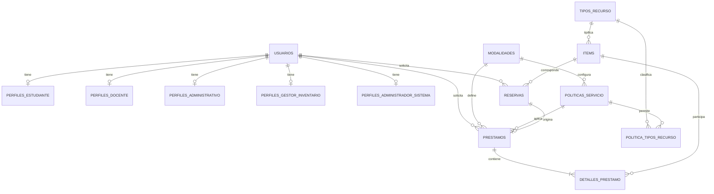

# Arquitectura del sistema

El proyecto separa el frontend Astro de la API Flask. El navegador nunca accede a
la base de datos: todas las operaciones pasan por `/api` y por las reglas del
backend.

```text
Astro → ruta Flask → servicio → dominio → repositorio → SQLAlchemy → base de datos
```

## Organización del backend

El código se agrupa por funcionalidad. Cada módulo implementado utiliza los mismos
cuatro archivos para que una operación pueda seguirse sin recorrer capas dispersas:

| Archivo | Responsabilidad |
| --- | --- |
| `dominio.py` | Entidades, estados, reglas e interfaz del repositorio. |
| `servicio.py` | Casos de uso y coordinación de las reglas. |
| `repositorio.py` | Consultas y escritura mediante SQLAlchemy. |
| `rutas.py` | Endpoints Flask y conversión a JSON. |

Los módulos `identidad/`, `inventario/`, `prestamos/`, `reservas/` y
`configuracion_servicio/` tienen recorridos funcionales. `sanciones/` y
`auditoria/` conservan únicamente el modelo de dominio previsto para los
Sprints 5 y 6; no se presentan como funcionalidades terminadas.

`compartido/` contiene autenticación, validaciones HTTP, errores, reloj e
identificadores comunes. `base_datos/` reúne la conexión, los modelos ORM, los
mapeadores, la unidad de trabajo, los datos opcionales de demostración y las
migraciones de Alembic.

## Petición y transacción

Por ejemplo, al registrar un préstamo:

1. `prestamos/rutas.py` valida el cuerpo HTTP y el permiso del usuario.
2. `prestamos/servicio.py` resuelve la política por rol y modalidad, y comprueba
   habilitación, tipos permitidos, cupo e ítems.
3. La unidad de trabajo crea una sola sesión para todos los repositorios.
4. El dominio calcula la fecha límite y registra la entrega.
5. Los repositorios guardan el préstamo y cambian los estados de los ítems.
6. Un único `commit` confirma la operación completa; cualquier error provoca `rollback`.

## Base de datos

La URL se obtiene de `DATABASE_URL`; si no está configurada se crea SQLite en
`backend/instance/prestamos.sqlite`. Cambiar la URL permite usar PostgreSQL sin
modificar servicios ni repositorios.



Los modelos SQLAlchemy están centralizados en `base_datos/modelos.py`. Las
migraciones `0001`–`0012` conservan la evolución desde el MVP y se aplican al
iniciar Flask. La migración `0011` normaliza políticas por rol y modalidad,
convierte los tipos permitidos en una relación y elimina las copias descriptivas
de `prestamos`. `0012` elimina los días de gracia: una reserva expira al terminar
su fecha reservada y esa fecha no se duplica en otra columna. Restricciones únicas parciales impiden que un mismo ítem aparezca
en dos préstamos activos o en más de una reserva activa. El diseño detallado se
documenta en [Préstamos y políticas](base-de-datos-normalizada.md).

## Frontend

`pages/` contiene las rutas Astro, `funcionalidades/` la lógica de cada pantalla y
`compartido/` el cliente HTTP, la sesión, los contratos TypeScript y las utilidades
de interfaz. Durante el desarrollo, Astro redirige `/api` hacia Flask usando
`API_PROXY_TARGET` o `http://127.0.0.1:5000` por defecto.
