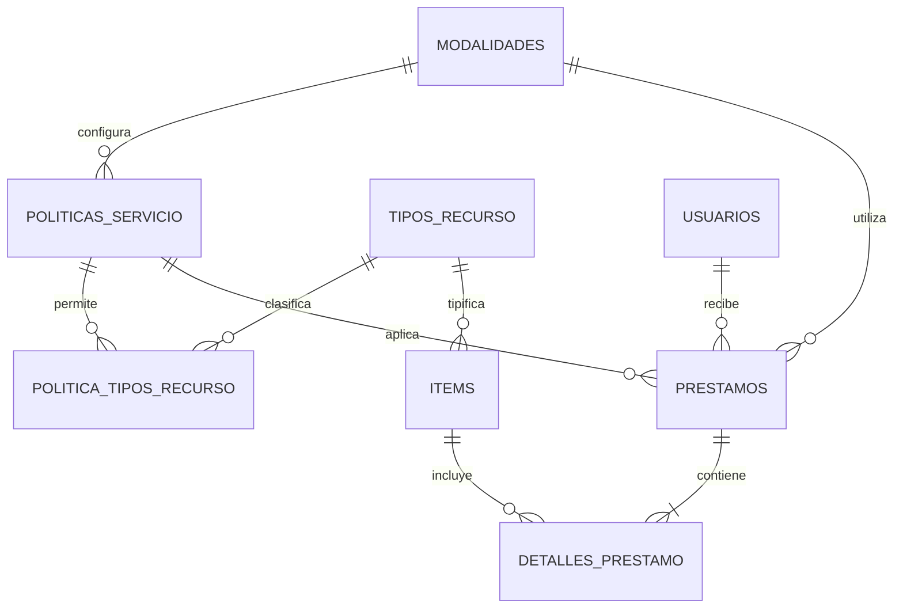

# Préstamos y políticas: modelo relacional normalizado

## Decisión de diseño

La migración `0011_normalizacion_politicas` elimina las copias descriptivas de
la cabecera del préstamo y lleva las reglas a la relación que realmente las
determina: **rol prestatario + modalidad**. El esquema queda en primera forma
normal y funciona sin variantes de SQL para SQLite y PostgreSQL.

`prestamos.dias_plazo` es el único valor deliberadamente histórico: registra los
días que se otorgaron en esa transacción. Si una política cambia después, un
préstamo anterior mantiene su fecha y plazo originales. El rol, el nombre de la
modalidad y los tipos permitidos no se copian; se consultan mediante llaves
foráneas y `JOIN`.

## Esquema resultante

| Tabla | Columnas relevantes | Integridad |
| --- | --- | --- |
| `modalidades` | `id`, `nombre`, `activo` | Nombre único; no contiene plazos. |
| `tipos_recurso` | `codigo`, `nombre` | Catálogo referenciado por inventario y políticas. |
| `politicas_servicio` | `id`, `rol_aplicable`, `modalidad_id`, `max_items_simultaneos`, `dias_prestamo`, `dias_gracia_reserva` | Una sola fila por `(rol_aplicable, modalidad_id)`; valores positivos y rol restringido. |
| `politica_tipos_recurso` | `politica_servicio_id`, `tipo_recurso_codigo` | PK compuesta y dos FKs; reemplaza la lista separada por comas. |
| `prestamos` | `id`, `usuario_id`, `reserva_id`, `modalidad_id`, `politica_servicio_id`, `dias_plazo`, fechas y renovaciones | Solo referencias y datos propios de la transacción. |

La aplicación ya modela los roles como valores institucionales controlados, por
lo que `rol_aplicable` se mantiene como texto con una restricción `CHECK`. Si en
el futuro los roles se vuelven administrables, podrá reemplazarse por `rol_id`
sin alterar la relación entre política y modalidad.

## Creación de un préstamo

La operación se ejecuta en una sola unidad de trabajo:

1. carga el usuario y comprueba que la cuenta y la vinculación del perfil estén vigentes;
2. carga la modalidad activa;
3. busca exactamente una política por `(rol_aplicable, modalidad_id)`;
4. carga los recursos, valida sus tipos mediante `politica_tipos_recurso` y comprueba el cupo;
5. cambia cada recurso de `DISPONIBLE` a `PRESTADO` de forma atómica;
6. calcula `fecha_devolucion_esperada` con `politicas_servicio.dias_prestamo`;
7. inserta la cabecera con `usuario_id`, `modalidad_id`, `politica_servicio_id` y el `dias_plazo` otorgado, y agrega sus detalles;
8. confirma una sola transacción; ante cualquier error revierte todos los cambios.

Las consultas reconstruyen `rol_solicitante` y `modalidad` uniendo
`prestamos`, `politicas_servicio` y `modalidades`. De este modo la API conserva
un contrato legible sin desnormalizar la base de datos.

## Políticas iniciales

| Rol | In situ | Externa | Cupo | Tipos permitidos |
| --- | ---: | ---: | ---: | --- |
| Estudiante | 1 día | 7 días | 3 | Libro, equipo y material |
| Docente | 1 día | 15 días | 5 | Libro, equipo, material y mobiliario |
| Administrativo | 1 día | 15 días | 5 | Libro, equipo, material y mobiliario |

El arranque de Flask garantiza estos valores de forma idempotente. Para una
carga SQL manual puede utilizarse
[`backend/scripts/semillas_politicas.sql`](../backend/scripts/semillas_politicas.sql).
La migración ejecutable completa está en
[`0011_normalizacion_politicas.py`](../backend/prestamos_academicos/base_datos/migraciones/versions/0011_normalizacion_politicas.py).

## Migración de datos existentes

`0011` crea primero las tablas nuevas, expande cada política anterior a sus
combinaciones por modalidad, transforma la lista de tipos en filas, vincula los
préstamos existentes con la política correspondiente y finalmente elimina las
columnas redundantes. La sustitución se hace dentro de la migración; no requiere
vaciar la base ni volver a crear usuarios, recursos, reservas o préstamos.

La migración es intencionalmente no reversible: reconstruir exactamente las
listas y copias eliminadas perdería la semántica normalizada. Antes de aplicarla
en producción debe existir una copia de seguridad verificada.
